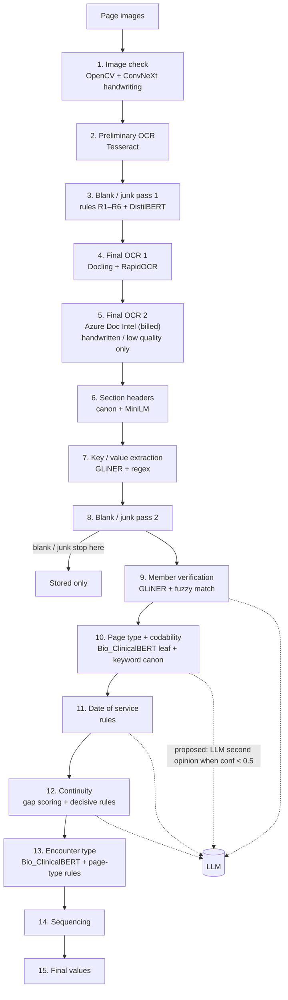

# Imaging Pipeline — Models, Workflow and Confidence

Which model each of the 15 stages uses, how every module reports a 0–1
confidence, and where an LLM would step in (proposed, not built). Companion
to [FLOW.md](FLOW.md) (what runs when) and [LOGIC.md](LOGIC.md) (how each
decision is made).

Nov 1, 2026 · copy of the Claude Doc <https://claude.ai/artifact/RSXP3QVvouGfrHgvpW2E9Y>

## Overview

The imaging pipeline turns a chart's scanned page images into one row of reviewed values per page: blank/junk, member, page type, codability, date of service (DOS), document grouping, encounter type and provider. It runs as 15 stages; each stage writes to Postgres and to staging files that review-ui reads.

It mixes three kinds of tools: OCR engines that read the page, small fine-tuned models (BERT-family classifiers and GLiNER entity extractors) that label it, and editable keyword/rule canons that check, correct or override the models. No large language model (LLM) runs today; the last section proposes where one would step in.

## Workflow



Stages run in order on every chart; blank and junk pages stop after stage 8, and only handwritten or low-quality pages go to the billed Azure OCR. Stages 9–15 can be re-run on their own from saved OCR (`skip_ocr`).

## Technology and models

Two GLiNER models and three BERT-family classifiers (DistilBERT blank/junk; Bio_ClinicalBERT page leaf and encounter) do the learned work; everything else is OCR engines, OpenCV and rules. Models run locally on CPU; only Azure Document Intelligence is a paid cloud call.

| Stage | What it decides | Technology / model | Fallback when missing |
| --- | --- | --- | --- |
| 1. Image check | Rotation, tilt, handwritten vs printed, quality, visible | OpenCV (Hough lines, sharpness/contrast); ConvNeXt-Tiny image classifier for handwriting (RandomForest backup) | Heuristic grade, stamped `hw_method=fallback` |
| 2. Preliminary OCR | First text for every page | Tesseract | — |
| 3, 8. Blank / junk / duplicate | Blank, junk (6 sub-types), duplicate, keep | Rules R1–R6 (no text, placeholder, card, visual, short page) + DistilBERT 8-label classifier; word-overlap duplicate check | Keyword vote |
| 4. Final OCR 1 | Text + word boxes + layout | Docling (Heron layout model) with RapidOCR (PP-OCR detection/recognition) | Tesseract text |
| 5. Final OCR 2 | Text for handwritten and low-quality pages | Azure Document Intelligence (billed per page) | Final OCR 1 text |
| 6. Section headers | Section headings on the page | Canon match + MiniLM sentence embeddings | Canon only |
| 7. Key/value extraction | Names, DOB, member ID, dates, signatures, page numbers (`extraction.json`) | GLiNER (fine-tuned span extractor) + regex | Rules only |
| 9. Member verification | Is this the manifest member? | GLiNER name/DOB/ID extraction + fuzzy matching against the manifest | Rules only; no page can be rejected |
| 10. Page type + codability | L1 > L2 > L3 page type, Codable / Non-Codable | Leaf classifier: Bio_ClinicalBERT (top-5 leaves) + per-leaf keyword canon (Must Have, Deciding, Negative...) | Page-axes BERT cascade, then keywords alone |
| 11. Date of service | DOS per page | Rules over `extraction.json` dates, strong label regex, signature date, neighbour consistency | — |
| 12. Continuity | Which pages form one document | Point-scored gaps (dates, page numbers, signatures, headings, "(continued)") + decisive rules | — |
| 13. Encounter type | Outpatient F2F, inpatient, telehealth, home (Progress, Procedure and Operative Notes only; blank otherwise) | Bio_ClinicalBERT encounter classifier + page-type rules, one vote per page | Rules only |
| 14–15. Sequencing + Final | Page order, final values, specialty, provider | Rules: document agreement, codability by credentials, provider-name cleanup | — |

Every degraded path is written into the data (method columns, `/health`), so a run without a model is visible, not silent.

## How confidence is calculated

Every module reports one confidence on the same 0–1 scale: **0.8 or above is good, below 0.5 goes to review**. A model's probability is the starting point; keyword evidence raises it, and disagreement or close calls lower it. Rule decisions carry fixed, documented values. None of these are calibrated yet; calibration against ground truth is the next step.

**The shared formula.** Every module uses the same two steps (`confidence_canon.json`):

```
conf = ( p + (1 − p) × 0.5 × s ) × Π penalties
```

- p = the model's probability; s = support in [0, 1] from keywords or rules backing the same value (s = 1 closes half the gap to 1).
- Penalties: keywords disagree ×0.7, no model ×0.85, fallback default ×0.6, conflict between sources ×0.8, overturned by a later pass ×0.7, handwritten ×0.9, thin text (<150 characters) ×0.85, degraded dependency ×0.6.

**Page type (leaf classifier).** Support s: 1.0 Deciding word in a header, 0.85 Deciding word on the page, 0.7 keyword rank 1, 0.45 rank 2–3, 0.25 rank 4–5. A close call (top two leaves within 0.1) ×0.9. Keywords alone: 0.4 + 0.5 × s. An Others leaf is capped at 0.6.

**Blank / junk.** The DistilBERT probability of the chosen label; a rule verdict takes its rule's value (strong card 0.95, visual page 0.90, short page contained in a nearby page 0.90).

**Date of service.** By where the date came from: key/value date in `extraction.json` 0.9, label at the page edge 0.8, keyword fallback 0.7, signature date 0.6, dictated date 0.5. A date filled from agreeing neighbour pages takes 0.9 × theirs.

**Member.** GLiNER's span score; member-ID rows count only above 0.9 and must be accepted and selected. The match to the manifest is a name/DOB/ID similarity; any one field matching counts as a match.

**Continuity.** Each page gap gets points (different date +3, signed previous page +2, page numbers running on −2, same date −3 ...). The total becomes P(break) = 1 / (1 + e^(−score/2)) and confidence = |2P − 1|. A decisive rule (signature, "(continued)", demographics, visit heading) holds it at 0.9 or more; a final-pass merge or split is ×0.7 (overturned).

**Final values.** A page carries its document's confidence; a value changed by document agreement or a fallback is flagged `needs_review`.

## LLM fallback plan (proposed, not built)

An LLM would be a second opinion only on values the pipeline already marks as unsure (confidence below 0.5), never a first pass. Expected volume is a small share of pages, so cost stays bounded; the share needs measuring on the next batch.

| Value | When the LLM is asked | What it gets | What it may return |
| --- | --- | --- | --- |
| Page type | Leaf confidence < 0.5, or model and keywords disagree | Page text (Final OCR), top 5 leaves with scores | One leaf from that list, or "none" |
| Date of service | No DOS found, or only a fallback date (signature, keyword pass) | Page text, the candidate dates with their labels | One candidate date, or "none" |
| Document break | Continuity gap with low confidence and no decisive rule | Last lines of page A, first lines of page B | Same document / new document |
| Member name | GLiNER and rules disagree with the manifest | The name spans found, the manifest name | Match / no match |

**Guardrails**

1. Closed answers only: the LLM picks from the candidates the pipeline gives it (structured JSON output), so it cannot invent a page type or date.
2. It never overrides a decisive rule (signature break, Deciding keyword, demographics boundary) or a value at 0.8 or above.
3. Its answer is stored as its own source (`decided_by = llm`) with the model name, and its value is flagged for review until accuracy on ground truth is measured.
4. PHI: pages contain member names and dates of birth, so calls go only to an endpoint covered by a BAA (for example Claude through a HIPAA-eligible cloud deployment); no page text in logs.
5. Budget: a per-chart cap on LLM calls, and the call is skipped (not failed) when the endpoint is down, stamped `degraded`.

**Model choice.** A small, fast model (Claude Haiku 5.5) for page type and DOS; a larger one (Claude Sonnet 5.5) only for continuity and member disputes, which need more reading.

**Open questions**

- [ ] Which BAA-covered endpoint is available to us?
- [ ] What share of pages falls below 0.5 today (sets the cost)?
- [ ] Should an LLM answer above a threshold clear `needs_review`, or always stay flagged?
